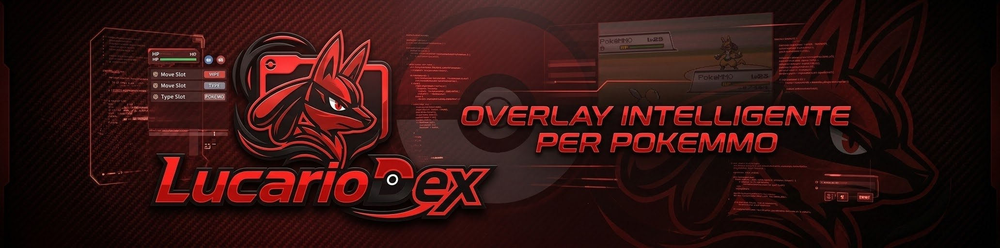

<p align="center">
  
</p>

<h1 align="center">LucarioDex</h1>
<p align="center"><b>Overlay informativo per PokeMMO · Beta v0.1.4</b></p>

<p align="center">
  
  
  
  
</p>

---

## Due parole prima di iniziare

LucarioDex nasce da un problema molto semplice: durante una cattura o una
lotta non hai voglia di aprire il browser, cercare il Pokémon, controllare le
debolezze, calcolare il danno e poi tornare al gioco. Così ho pensato a un
pannello che resta sopra PokeMMO e ti dà quelle informazioni mentre giochi.

Non tocca il client, non legge la memoria, non manda input al gioco e non fa
nulla al posto tuo. Prende solo l'immagine della finestra di PokeMMO e la
interpreta. Per questo i click possono passare tranquillamente al gioco: è un
overlay, non un bot. Se ti interessa il lato "legale", ne parlo anche in fondo
alla guida.

In breve:

- Pokédex completo con statistiche, tipi, abilità, evoluzioni e zone di cattura.
- Efficacia, mosse lette a schermo, danno stimato, pericolo e calcolo cattura.
- Pannello **Zona** con spawn, rarità, livelli, EV e specie già catturate.
- **Guida turni** per palestre, Elite 4, farm e percorsi personalizzati.
- **Ditto Farm** per non mandare KO Ditto prima della cattura.
- **PvP** con squadra, avversario, campo, ordine di turno e stime di danno.
- **StratDex**: set e mosse più usati, con benchmark di velocità per tier.
- **Catena di catture** della stessa specie, usata dalle ball condizionali.
- **Aggiornamenti integrati** nella build installata, con download e verifica.
- Interfaccia in italiano o inglese, temi, profili e scorciatoie configurabili.

Questa guida è scritta per essere letta dall'inizio alla fine la prima volta,
e poi consultata solo quando serve. Non serve configurarla in modo particolare:
con le impostazioni di default funziona già.

---

## Cosa ti serve

- **Windows 10 o 11**.
- **PokeMMO** avviato. Va bene sia in finestra sia in borderless.
- Il file **`LucarioDex-Setup-0.1.4.exe`** (dentro la cartella `dist`), oppure
  il sorgente se vuoi avviarlo con Python.

L'installer è per utente e non richiede permessi da amministratore. Di default
installa in `%LOCALAPPDATA%\LucarioDex` e crea la voce nel menu Start. La
scorciatoia sul desktop è opzionale.

### Se lo avvii dal codice

Servono **Python 3.12 o successivo** e le dipendenze del progetto:

```powershell
python -m pip install PyQt6 opencv-python-headless numpy Pillow rapidfuzz rapidocr-onnxruntime onnxruntime
python app.py
```

Se stai usando la build già pronta non devi installare nulla a mano: OCR,
modelli e dataset sono già inclusi nell'eseguibile.

---

## Primo avvio, passo per passo

1. Apri **PokeMMO** e mettiti nella schermata che ti interessa (incontro,
   battaglia, percorso).
2. Avvia **LucarioDex**.
3. L'overlay compare sopra il gioco. In basso vedi `Gioco: connesso` quando la
   finestra di PokeMMO viene riconosciuta.
4. Premi **Scansiona** per fare una lettura manuale, oppure attiva **Auto** per
   la scansione automatica (lo trovi anche nelle impostazioni e nel menu della
   tray). Dopo ogni lettura, la riga in fondo mostra l'ora dell'ultima
   scansione.
5. Quando hai finito di sistemare posizione e dimensioni, disattiva la
   **modalità modifica** con `Ctrl + Alt + C`. Così i click passano al gioco
   invece di fermarsi sull'overlay.

La prima volta comparirà un promemoria con le scorciatoie principali. Puoi
ignorarlo: non blocca nulla.

> Consiglio pratico: lascia l'overlay in modalità modifica finché devi
> spostarlo o ridimensionarlo. Mentre lo trascini compaiono le guide di
> allineamento e, al rilascio, l'overlay si aggancia ai bordi dello schermo o
> della finestra di gioco. Poi bloccalo con l'icona del lucchetto nella barra
> del titolo e disattiva la modalità modifica. Da quel momento non lo sposti più
> per sbaglio.

Se avvii LucarioDex due volte, la seconda istanza non apre una copia: riporta
in primo piano la finestra già aperta.

---

## La schermata principale

La finestra è divisa in poche zone, sempre le stesse:

- **Barra del titolo**: trascina da qui per spostare l'overlay. A destra hai i
  pulsanti per compattare, bloccare la posizione e aprire le impostazioni.
- **Barra di ricerca del Pokédex**: scrivi il nome di una specie e premi Invio.
  Si apre la scheda completa senza uscire dall'overlay.
- **Scheda Nemico**: nome, livello, PS, stato, tipi, velocità base e, se serve,
  badge **Alpha**, orda o secondo avversario. Sotto trovi le schede rapide.
- **Le quattro schede**:
  - **Efficacia**: debolezze, resistenze e immunità del nemico.
  - **Mosse**: le tue mosse lette a schermo, ordinate per danno stimato, con la
    migliore in cima.
  - **Pericolo**: quanto danno rischi di subire dai Pokémon avversari.
  - **Cattura**: probabilità, ball consigliata, media dei lanci e costo
    atteso in Poké Yen (₽).
- **Il mio Pokémon**: la specie che stai usando, con livello, IV, EV e natura.
  Puoi compilare anche un secondo slot per le lotte in doppio. Se attivi
  **Rileva i miei Pokémon**, LucarioDex prova a compilarli da sola durante la
  scansione. Puoi comunque sistemarli a mano.
- **Pulsanti in basso**: **Scansiona**, **Auto** e la riga **Zona · Guida ·
  Ditto · PvP**. I quattro pulsanti aprono i rispettivi pannelli e restano
  evidenziati mentre sono aperti. Nella riga in fondo vedi lo stato della
  connessione, la versione e l'ora dell'ultima scansione; cliccala per aprire
  le impostazioni. Quando catturi più esemplari della stessa specie di fila
  compare anche il badge **Catena**, che alimenta il bonus delle ball
  condizionali come la Repeat Ball.

### Come leggere la scheda Mosse

La mossa in cima è quella che, secondo i dati inseriti, fa più danno medio.
Accanto vedi la percentuale stimata sui PS del nemico e una barra colorata:
verde se sei messo bene, gialla se è una situazione intermedia, rossa se il
colpo è pesante. Se non hai impostato il tuo Pokémon, il danno non può essere
calcolato: in quel caso compila la scheda **Il mio Pokémon** (anche solo
specie, livello e natura) e la stima compare subito.

I selettori di stadio (le frecce vicino alle statistiche) servono per tenere
conto di danze e debuff. Se il nemico ha usato una mossa che gli abbassa la
difesa, o tu hai potenziato l'attacco, aggiornali: il numero cambia di
conseguenza.

### Cattura: perché cambia da sola

La probabilità dipende da PS attuali, stato, specie e ball scelta. Durante la
lotta LucarioDex rilegge quei valori e ricalcola tutto. La ball consigliata è
quella con il miglior rapporto tra probabilità e costo, non semplicemente la
più forte. Le ball speciali (Repeat, Net, Nest, Dusk, Quick, Timer, Dream)
vengono considerate quando la situazione le rende convenienti.

Accanto alla probabilità vedi anche la stima dei lanci necessari e il costo
complessivo. Se hai una catena attiva della stessa specie, la Repeat Ball ne
tiene conto: il badge **Catena** in fondo all'overlay mostra il conteggio. Se un
numero non ti torna, controlla prima di tutto i PS e lo stato: sono loro a
spostare di più la percentuale.

---

## Scansione automatica e lettura del turno

La scansione automatica fa una lettura ogni pochi secondi. È comoda quando
stai facendo incontri di fila, ma ha un costo: più spesso scansiona, più lavoro
fa il computer. Il default è un compromesso ragionevole.

Due opzioni che vale la pena conoscere:

- **Solo in battaglia**: evita di scansionare mentre cammini. Utile se vuoi
  risparmiare risorse e non ti interessa la lettura della zona.
- **Leggi turno (lento)**: aggiunge il riconoscimento del numero di turno.
  Serve alla Guida automatica, ma è più lento. Attivalo solo se ti serve
  davvero.

Se la scansione non riconosce nulla, quasi sempre è perché il gioco è
minimizzato, coperto da una finestra non prevista o in una risoluzione molto
diversa da quella standard. Prova a mettere PokeMMO in primo piano e a
rieseguire la scansione manuale. Quando il gioco è in schermo intero, usa la
modalità corrispondente nelle impostazioni.

---

## Zona: cosa può apparire dove sei

Apri il pannello col pulsante **Zona** nella riga strumenti (oppure `Zona` dal
menu della tray). Il pannello mostra la zona corrente e i Pokémon che vi
compaiono, con:

- metodo di incontro (erba, grotta, acqua, pesca, bottintesta, ombra, ecc.);
- rarità, livelli minimi e massimi;
- EV assegnati;
- contatore di quelli già presi e specie che mancano in quella zona;
- indicazione delle orde quando presenti.

Clicca su una riga per segnarla come catturata: il contatore si aggiorna e
resta salvato. Se lo stesso nome di zona esiste in più regioni, usa il
**selettore di regione** in alto per filtrare la lista. Se non vuoi filtrare,
lascia **Tutte le regioni**.

La zona viene ricavata dal testo a schermo, quindi conviene fare la scansione
quando il nome dell'area è visibile e non coperto da menu o finestre.

---

## Pokédex

La barra di ricerca in alto apre la scheda di qualsiasi specie presente nei
dati. Dentro trovi:

- statistiche base e totale;
- tipi, abilità (compresa quella nascosta, dove disponibile);
- altezza, peso, tasso di cattura, genere e gruppi uovo;
- tier e indicazione di leggendario, dove previsto;
- evoluzioni con il metodo richiesto;
- mosse apprese per livello;
- dove trovarla;
- sprite (animato dove disponibile).

La scheda si apre sopra il pannello principale. Con **Indietro** torni a dove
eri. Se una specie è già stata vista o catturata, lo stato viene ricordato e
compare anche nei profili salvati.

---

## Guida turni

La Guida è un promemoria passo-passo per combattimenti scriptati: palestre,
Elite 4, farm, Red o qualsiasi percorso tu voglia. Non decide per te e non
preme nulla nel gioco.

Come si usa:

1. Apri il pannello col pulsante **Guida** (o `Guida turni` dalla tray).
2. Scegli un percorso dal menu a tendina.
3. A ogni turno premi **Avanti**, oppure usa `Ctrl + Shift + N`.
4. Se sbagli, **Indietro** torna al passo precedente; **Azzera** riparte
   dall'inizio.

Se il percorso dichiara un **roster**, il pannello mostra il team avversario
possibile e lo restringe man mano che le specie compaiono. Quando sono state
viste tutte, scrive `Tutte le specie osservate`.

I percorsi personali stanno in **`routes_user.json`**, nella cartella dei dati
utente (vedi più sotto). Il formato è lo stesso di `data/routes.json`: puoi
copiare un esempio, cambiare nome, passi e roster, e riavviare LucarioDex. Se
un percorso ha dei passi con il campo `turn`, la guida può avanzare da sola
quando il turno letto dall'OCR raggiunge quel valore. Per i dettagli del
formato c'è `docs/routes.md`.

> La Guida è pensata per essere letta, non per giocare al posto tuo. Se un
> passo non scatta da solo, controlla che **Leggi turno** sia attivo e che il
> numero di turno sia visibile a schermo.

---

## Ditto Farm

Il pannello **Ditto Farm** serve a non mandare KO Ditto prima di catturarlo.
Si apre col pulsante **Ditto** o con `Ctrl + Shift + D`.

Cosa gli serve:

- il tuo **lead** (specie, livello, IV, EV, natura);
- la **mossa** che usi (per esempio False Swipe);
- il **livello** e i **PS** di Ditto.

In cambio ti mostra il danno stimato su un Ditto normale e su un Ditto dopo
**Transform**, che difende come il tuo lead ma mantiene i suoi PS. Il pannello
ti avvisa se rischi il KO, ti suggerisce la ball migliore a PS pieni e a 1 PS
con sonno, e tiene il conto delle catture con **+1 cattura**.

La nota su False Swipe è volutamente esplicita: se la mossa non può mettere KO,
il rischio scende quasi a zero. Se usi un attacco normale, a PS bassi il KO è
dietro l'angolo. Le zone migliori per trovarlo sono elencate nello stesso
pannello.

---

## PvP

La modalità PvP si attiva dal pulsante **PvP**. Sostituisce il pannello PvE
con quattro schede:

- **Squadra**: i tuoi sei slot, con specie, livello, natura, oggetto, abilità,
  mosse, IV/EV e boost. Puoi salvare gli slot nei **box**, ricaricarli,
  eliminarli, importare o esportare un set in formato Showdown. I preset
  aiutano a partire da un set sensato per la specie scelta.
- **Avversario**: il set del Pokémon che hai davanti, anche parziale. Le mosse
  lette a schermo restano compilate per tutta la battaglia: una lettura
  incerta non le cancella. Cambiano solo quando cambi Pokémon o quando la
  battaglia finisce, e il pannello si ridisegna solo se qualcosa è davvero
  cambiato.
- **Campo**: meteo, Trick Room, Riflesso, Schermo Luce, Venti Rapidi,
  Stealth Rock, Spikes e Toxic Spikes, per entrambi i lati.
- **Danno**: ordine di turno e velocità effettiva dei due Pokémon, poi i tuoi
  attacchi e quelli avversari ordinati per danno. Ogni riga è colorata e
  riempita in base alla percentuale: verde quando il colpo è forte a tuo
  favore, rosso quando lo subisci. A destra leggi il danno, i **PS che
  restano** al bersaglio (`resta 63%`), la precisione e il badge con i colpi
  necessari al KO (OHKO, 2HKO…, oppure `61–92` se serve più di un turno).
  L'ultima riga con **＋** somma le due mosse migliori. Gli effetti di entrata,
  i residui e l'oggetto stanno in fondo; se mancano i dati, il pannello ti
  porta direttamente alla scheda da compilare.

È uno strumento di supporto, non un calcolatore ufficiale: se un dato del set
avversario è inventato, anche la stima lo sarà. Compila solo ciò che sai e
lascia vuoto il resto.

### StratDex: dati d'uso comuni

StratDex è **sempre attivo** quando `meta.json` contiene dati validi: non c'è
nessun interruttore da sbloccare. Integra i dati pubblici di
[mmoshowdown.com](https://mmoshowdown.com/dex), raccolti dal client PokeMMO
Showdown. Non sono dati ufficiali della ladder: vanno letti come
**probabilità**, non come certezza.

Cosa aggiunge:

- nella scheda **Avversario**, il riquadro **Uso comune (StratDex)** con
  selettore del tier, chip delle mosse più usate (il riempimento indica la
  percentuale), **Applica set più usato**, oggetto, abilità, spread e compagni
  frequenti;
- nel menu **Preset** (squadra e avversario) i set disponibili per la specie,
  ad esempio `Garchomp · OU`;
- nella scheda **Danno**, il pulsante **Benchmark velocità**: tabella delle
  velocità effettive a livello 50 nel tier scelto, con ricerca, spread più
  usato e indicazione di chi è più veloce del tuo Pokémon attivo.

I set importati possono essere esportati in formato Showdown con il normale
pulsante **Esporta set**, quindi finiscono nei box come qualsiasi altro set.

I dati stanno in **`meta.json`**. Il programma ne usa una copia modificabile a
mano accanto alle impostazioni:

| Come gira LucarioDex | File da modificare |
| --- | --- |
| Installer / `.exe` | `%APPDATA%\LucarioDex\meta.json` |
| Sorgenti (`python app.py`) | `meta.json` nella cartella del progetto |

`data/meta.json` è la copia inclusa nell'app: viene usata per creare il file
utente la prima volta e come riserva se il file utente manca o non è valido.
Cancellare il file utente ripristina i dati inclusi. Il file viene riletto
automaticamente quando cambia, senza riavviare l'app. Per provare senza toccare
il file reale: `$env:LUCARIODEX_META = "C:\temp\meta.json"`.

Lo schema completo, il formato delle percentuali e il significato dei campi
sono documentati in **[`FEATURES.md`](FEATURES.md)**.

Per rigenerare il dataset incluso:

```powershell
python tools\build_stratdex.py
python tools\build_stratdex.py --tiers ou,uu --limit 5   # prova veloce
```

---

## Aspetto e impostazioni

Apri le impostazioni con l'ingranaggio nella barra del titolo o con
`Ctrl + Alt + S`.

**Aspetto**

- Opacità dell'overlay.
- Mostra o nascondi l'intestazione.
- Sempre in primo piano.
- Modalità modifica (se è OFF, i click passano al gioco).
- Tema scuro o chiaro e colore accento.
- Scansione automatica e opzione **Solo in battaglia**.
- Rilevamento automatico dei tuoi Pokémon.
- Blocco della posizione.
- Scala del testo e alto contrasto.
- Sfondo personalizzato con una tua immagine.

**Gioco**

- Ancoraggio al gioco e posizione dell'ancoraggio (alto/basso,
  sinistra/destra).
- Modalità della finestra di gioco: finestra, borderless o schermo intero.
- Lettura schermo automatica o manuale.
- Lingua: italiano o inglese.

**Scorciatoie**

Puoi cambiare i tasti per mostrare/nascondere l'overlay, la modalità modifica,
le impostazioni e il passo avanti della Guida. Clicca sul campo, premi la
combinazione che vuoi e chiudi: viene salvata subito.

**Profili**

Salva una configurazione completa con un nome, richiamala quando serve ed
eliminala se non ti serve più. Oltre a tema, posizione e dimensione, il
profilo ricorda anche lo stato del Pokédex (visti e catturati) e le
impostazioni dei pannelli. Utile se giochi su più personaggi o vuoi due layout
diversi.

**Aggiornamenti**

Qui vedi la versione installata e il pulsante **Cerca aggiornamenti**. Nella
build installata il controllo parte anche da solo all'avvio, in background.

---

## Aggiornamenti

La versione installata controlla le release su GitHub e, se trova una versione
più recente, mostra le note e due scelte:

- **Aggiorna ora**: scarica l'installer, lo verifica se la release fornisce un
  checksum SHA-256, chiude LucarioDex e avvia il setup. I dati utente in
  `%APPDATA%\LucarioDex` restano al loro posto.
- **Salta (non consigliato)**: avvia la versione attuale e ricorda quella
  scelta, così non viene riproposto lo stesso avviso a ogni avvio.

Se il controllo non riesce (per esempio senza rete), l'app continua a
funzionare normalmente. Se avvii dal sorgente, l'aggiornamento automatico non è
disponibile: il pulsante apre la pagina delle release per scaricare la nuova
versione.

Il controllo aggiornamenti è l'unica connessione di rete dell'app. Non invia
dati d'uso, statistiche o contenuti del gioco: contatta solo l'API pubblica di
GitHub per leggere l'ultima release.

Per pubblicare un aggiornamento, crea una release su
`https://github.com/WolfHitech/LucarioDex/releases` con tag `v<versione>` e
allega l'installer chiamandolo esattamente `LucarioDex-Setup-<versione>.exe`
(es. `LucarioDex-Setup-0.1.5.exe`). Se aggiungi anche
`LucarioDex-Setup-<versione>.exe.sha256`, il download viene verificato prima
di avviare il setup.

---

## Scorciatoie predefinite

| Scorciatoia        | Azione                              |
|--------------------|-------------------------------------|
| `Ctrl + Alt + H`   | Mostra / nascondi l'overlay         |
| `Ctrl + Alt + C`   | Modalità modifica ON/OFF            |
| `Ctrl + Alt + S`   | Apri le impostazioni                |
| `Ctrl + Shift + N` | Guida: passo successivo             |
| `Ctrl + Shift + D` | Ditto Farm: mostra / nascondi       |

Le prime quattro sono modificabili dalle impostazioni. `Ctrl + Shift + D` è il
default del pannello Ditto.

---

## Icona nella tray

LucarioDex resta anche nell'area di notifica. Con il tasto destro trovi:

- **Scansiona**;
- **Impostazioni**;
- **Zona**, **Guida turni**, **Ditto Farm**;
- **Modalità modifica**;
- **Leggi turno (lento)**;
- **Scansione automatica**;
- **Esci**.

La X chiude l'app e salva le impostazioni. Se vuoi solo togliere l'overlay
dalla vista, usa `Ctrl + Alt + H` o l'opzione compatta. Per terminare tutto
dalla tray c'è comunque **Esci**. Il pannello PvP si apre dal pulsante
**PvP** nell'overlay.

---

## Dove stanno i file

Se usi la versione installata, configurazione e dati utente stanno in:

```text
%APPDATA%\LucarioDex
```

Qui trovi:

| File | Contenuto |
| --- | --- |
| `config.json` | impostazioni, profili, squadre PvP, stato dei pannelli |
| `dex_state.json` | Pokémon visti e catturati |
| `routes_user.json` | i tuoi percorsi della Guida |
| `meta.json` | dati d'uso StratDex, se vuoi personalizzarli |

Se avvii dal sorgente, gli stessi file stanno nella cartella del progetto.

Il file di log degli errori viene scritto in:

```text
%TEMP%\LucarioDex_error.log
```

Se l'app si chiude da sola, quello è il primo posto da guardare.

---

## Se qualcosa non funziona

**L'overlay dice `Gioco: assente`.**
PokeMMO non è aperto, è minimizzato o il titolo della finestra non viene
riconosciuto. Metti il gioco in primo piano e premi di nuovo **Scansiona**.

**Non riconosce il Pokémon.**
Prova una scansione manuale con il gioco in primo piano. Se il problema resta,
controlla che la risoluzione non sia troppo diversa da quella standard e che
non ci siano menu aperti sopra la barra dei PS o il nome.

**La modalità modifica è attiva e non riesco a cliccare il gioco.**
Premi `Ctrl + Alt + C` oppure disattivala dalle impostazioni o dalla tray. In
modalità modifica i click restano sull'overlay: è voluto, serve per spostarlo e
ridimensionarlo.

**La scansione automatica è lenta.**
Attiva **Solo in battaglia** se non ti serve la lettura della zona, oppure
passa alla scansione manuale. Se hai attivato **Leggi turno**, tienilo conto:
è l'opzione più pesante.

**I numeri di danno non tornano.**
Controlla specie, livello, natura, IV/EV e i selettori di stadio. Una natura
sbagliata o un boost non aggiornato sposta parecchio la stima.

**Ho cambiato risoluzione o monitor.**
Riposiziona l'overlay, poi ribloccalo. Se usi l'ancoraggio al gioco, verifica
che la modalità (finestra, borderless, schermo intero) corrisponda a come stai
giocando.

**StratDex non compare.**
Controlla che `meta.json` esista e sia un JSON valido. Se il file è rotto, la
scheda continua a mostrare l'ultima versione valida e segnala l'errore nel piè
di pagina. Cancellando il file utente torni ai dati inclusi.

**L'aggiornamento non parte.**
L'aggiornamento automatico funziona solo con la versione installata. Controlla
la connessione e, se serve, scarica l'installer dalla pagina delle release. Se
la release fornisce un checksum e il file scaricato non coincide, il download
viene annullato per sicurezza.

**L'app si chiude o non parte dal codice.**
Apri `%TEMP%\LucarioDex_error.log`. Se manca l'OCR, reinstalla le dipendenze con
il comando della sezione "Se lo avvii dal codice".

---

## Sviluppo

### Struttura del progetto

```text
app.py                 punto di ingresso
src/                   codice dell'app
data/                  dataset PokeMMO, traduzioni, sprite e meta.json
assets/                icone, banner, sfondi
tools/                 build dataset, verifica dati, self-test
tests/                 suite di test
installer/             script Inno Setup
docs/                  documentazione tecnica
debug/                 script e immagini per il debug dell'OCR
dist/                  build e installer generati
```

Moduli principali:

- `src/window.py` — finestra, impostazioni, tray, hotkey e scansione.
- `src/dexpanel.py` — pannello battaglia, efficacia, mosse, pericolo, cattura.
- `src/dexview.py` — scheda Pokédex.
- `src/zonepanel.py` / `src/zone.py` — pannello Zona e lookup degli spawn.
- `src/routepanel.py` / `src/routes.py` — Guida turni.
- `src/dittofarm.py` — pannello Ditto.
- `src/pvppanel.py` / `src/pvp.py` — interfaccia e motore di calcolo PvP.
- `src/stratdex.py` — caricamento e normalizzazione di `meta.json`.
- `src/guides.py` — guide magnetiche e anteprima di aggancio durante il
  trascinamento della finestra.
- `src/updater.py` — controllo delle release GitHub e aggiornamento guidato.
- `src/vision.py`, `src/ocr.py`, `src/recognize.py`, `src/battle_reader.py`,
  `src/moves.py` — cattura schermo, OCR e lettura della battaglia.
- `src/pokedata.py`, `src/catchcalc.py`, `src/damage.py` — dati e calcoli.
- `src/config.py`, `src/dexstate.py`, `src/i18n.py`, `src/theme.py` —
  persistenza, stato del dex, traduzioni e tema.

### Test

La suite gira anche senza PokeMMO e senza salvare dati nel repository:

```powershell
python tests\run_all.py
```

Imposta `QT_QPA_PLATFORM=offscreen`, esegue `tools/verify_data.py` e tutti i
file `tests/test_*.py`. I test che dipendono da fixture mancanti vengono
saltati senza fallire. La CI in `.github/workflows/ci.yml` esegue la stessa
suite su Windows.

### Build

La build è **onedir** con PyInstaller e l'installer con Inno Setup 6:

```powershell
pyinstaller --clean --noconfirm LucarioDex.spec
ISCC.exe installer\LucarioDex.iss
```

Il risultato sta in `dist\LucarioDex` e l'installer in
`dist\LucarioDex-Setup-0.1.4.exe`. Il numero di versione va tenuto allineato in
`src/__init__.py`, `version_info.txt` e `installer\LucarioDex.iss`.

### Dati

I dataset in `data/` sono scelti per **PokeMMO**, non per i giochi mainline:

- `monster.json`, `moves.json` — specie, forme, statistiche e movepool.
- `encounters.json` — spawn per zona, metodo, rarità e livelli.
- `ev_yields.json` — EV assegnati, incluse le forme.
- `species_core.json`, `balls.json`, `status_rates.json` — cattura.
- `legendaries.json`, `move_flags.json`, `move_accuracy.json` — supporto ai
  calcoli e ai filtri PvP.
- `calibration.toml` — coordinate e soglie dell'HUD.
- `lang/`, `sprites/` — traduzioni, nomi e immagini.
- `meta.json` — dati d'uso StratDex.
- `routes.json` — percorsi dimostrativi della Guida.

Il controllo di conformità e provenienza è descritto in
[`docs/data_audit_pokemmo.md`](docs/data_audit_pokemmo.md) ed eseguito da:

```powershell
python tools\verify_data.py
```

A runtime LucarioDex legge i dati dai file locali e, per StratDex, può
ricaricare `meta.json` quando cambia. L'unica connessione di rete è il
controllo aggiornamenti descritto sopra: avviene solo nella build installata
su Windows e non invia dati del gioco o della configurazione.

---

## Fonti e attribuzioni

- Dati di gioco: datamine e progetti della community PokeMMO
  (PokeMMO-Tools, PokeMMOZone/Data e affini), verificati in
  `docs/data_audit_pokemmo.md`.
- Dati d'uso StratDex: [mmoshowdown.com](https://mmoshowdown.com/dex) —
  client PokeMMO Showdown.
- LucarioDex non è affiliato a PokeMMO, Showdown o mmoshowdown.

---

## Feedback

La beta serve proprio a trovare i casi strani. Se segnali qualcosa, cerca di
includere:

- cosa stavi facendo e cosa ti aspettavi;
- uno screenshot dell'overlay e del gioco nello stesso momento;
- zona e Pokémon coinvolti;
- la versione che vedi in basso nell'app.

Canale ufficiale: `t.me/lndefinizione`

Se il problema è un errore, allega anche `%TEMP%\LucarioDex_error.log`: fa
risparmiare un sacco di domande.

---

## Legal

LucarioDex è un **overlay puramente informativo**. Non modifica il client di
PokeMMO, non inietta codice, non legge memoria, socket o file di gioco e non
automatizza azioni. Analizza soltanto l'immagine della finestra di gioco. Non è
un bot e non è un cheat.

L'uso resta a responsabilità dell'utente. Se PokeMMO cambia interfaccia o
regole, alcune letture potrebbero smettere di funzionare: in quel caso meglio
aspettare un aggiornamento che forzare il programma.

<p align="center">
  <sub>Beta v0.1.4 · documentazione aggiornata il 28 ottobre 2026 · made by @WolfHitech · grazie per giocare e testare assieme a me.</sub>
</p>
